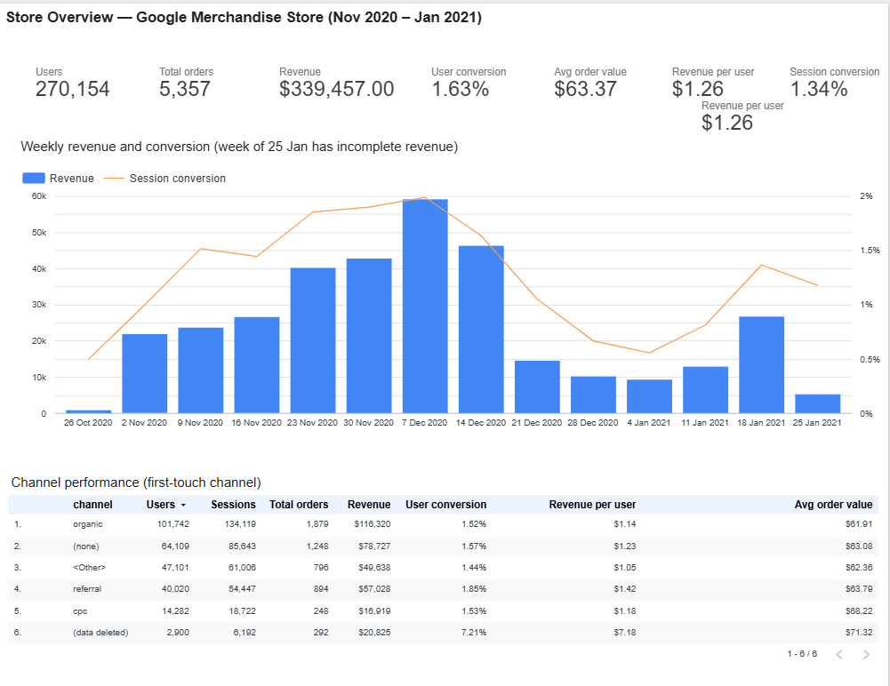
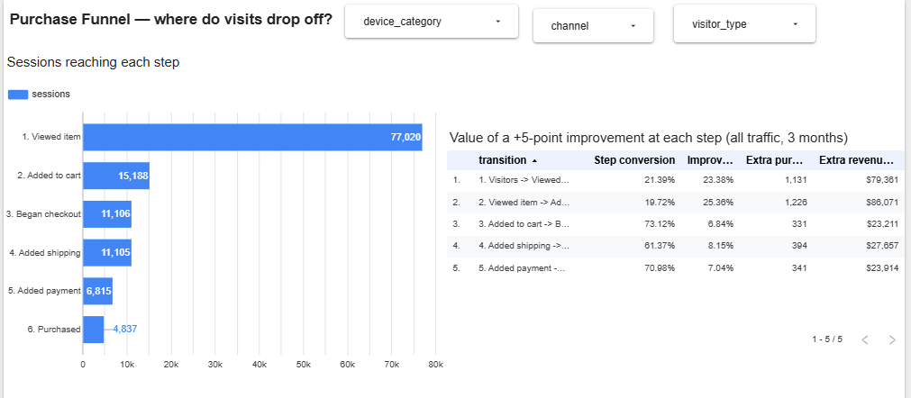
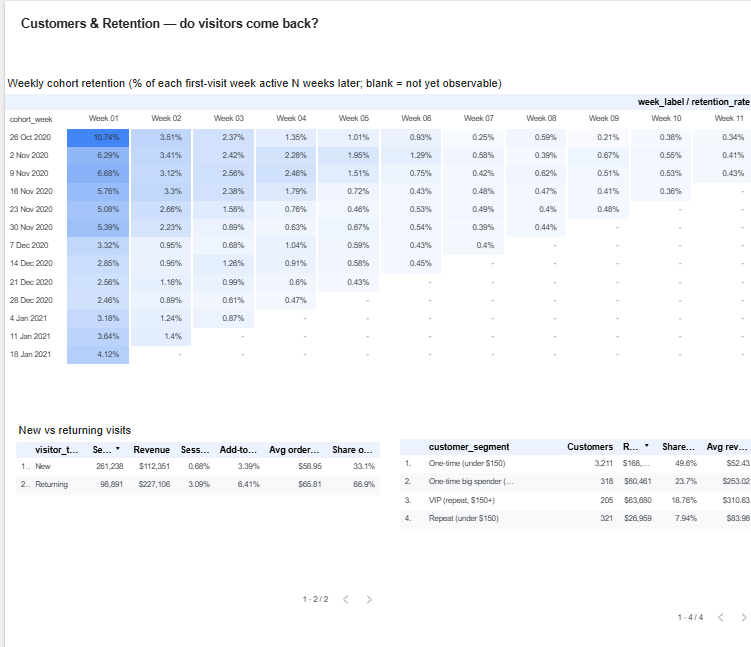
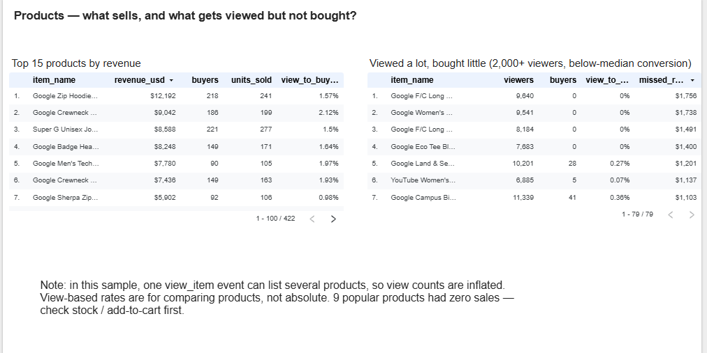
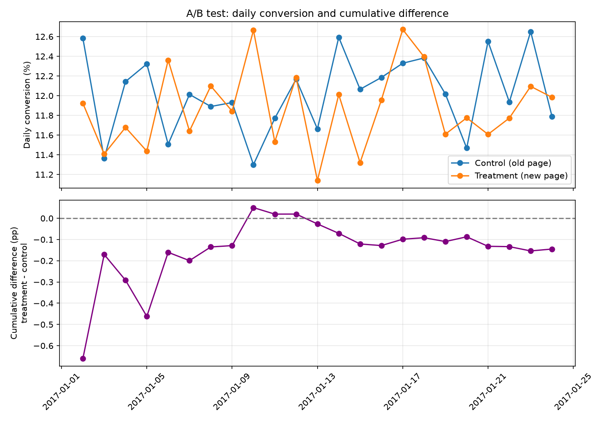

# E-commerce Product Analytics — Google Merchandise Store (GA4 + BigQuery)

Product analytics on **4.3 million real GA4 events** from Google's online merchandise store (Nov 2020 – Jan 2021): where shoppers drop off, which channels bring buyers, whether customers come back, and whether a new landing page should launch.
**BigQuery (SQL) · GA4 data · Data Studio (Looker Studio) · Python (pandas, SciPy, statsmodels) · A/B testing**

---

## Key Results
- **Biggest quick win — the shipping step:** 39% of shoppers who enter shipping details never reach payment. A +5-point improvement ≈ **$27.7K** (3-month window) and needs only an 8% relative improvement
- **Biggest bet — the product page:** only **19.7%** of product views lead to add-to-cart; +2 points ≈ **$34.5K**, +5 points ≈ **$86K**
- **Returning visits are worth 5.3× a first visit** ($2.30 vs $0.43 revenue per session) and bring **67% of revenue** — yet only 3–6% of new visitors return the next week
- **9 popular products had zero sales** despite 2,000–9,600 viewers each → likely stock or add-to-cart issues
- **A/B test: do not launch the new landing page** — −1.2% (p = 0.232); 95% CI −3.2% to +0.8%, so even the best case is below a +2% worthwhile lift
- **Data-quality catches:** removed 335 duplicate purchase events (revenue was overstated by **6.3%**), excluded a week with 70% missing revenue, and removed 3,893 A/B-test users who saw both pages

---

## Business Problem
Acting as a Product Analyst, the Product Manager asks:
1. Where do customers drop off between viewing a product and buying?
2. Which channels, devices and countries bring valuable customers, not just visitors?
3. Do customers come back, and who are the most valuable customers?
4. Should the new landing page be launched, and how should future tests be sized?

**North Star metric:** revenue per user = conversion × average order value × orders per purchaser = 1.63% × $63.37 × 1.22 = **$1.26**
Full metrics framework and the 12 business questions: [`docs/business_questions.md`](docs/business_questions.md)

---

## Dashboard (Data Studio / Looker Studio, connected live to BigQuery)

**Overview:** KPIs, weekly revenue and conversion through the holiday season, channel performance


**Funnel:** sessions reaching each step (filterable by device, channel, new vs returning) and the $ value of improving each step


**Customers & Retention:** weekly cohort retention heatmap, new vs returning visits, customer segments


**Products:** top products, and popular products that get viewed but not bought


---

## Funnel and Opportunity Sizing
| Step | Sessions | Step conversion |
|---|---|---|
| All sessions | 360,129 | — |
| Viewed item | 77,020 | 21.4% |
| Added to cart | 15,188 | **19.7%** (weakest step) |
| Began checkout | 11,106 | 73.1% |
| Added shipping | 11,105 | — |
| Added payment | 6,815 | **61.4%** (most valuable leak) |
| Purchased | 4,837 | 71.0% |

Because funnel steps multiply, **a relative improvement at any step raises revenue by the same %** — so fixes were prioritised by effort and likelihood, not raw dollars. Every device and channel leaked at the same two steps (within ~3 points) → store-wide fixes.

---

## A/B Test — New Landing Page
| Step | Result |
|---|---|
| Data quality | 3,893 users saw both pages → removed entirely; 286,691 clean users |
| Sample Ratio Mismatch | 50.02% treatment, p = 0.845 → split is trustworthy |
| Conversion | Old 12.02% vs new 11.87% → **−1.2%**, p = 0.232 |
| 95% CI (relative) | **−3.18% to +0.77%** → a +2% lift is ruled out |
| Novelty check | New page slightly behind in every period; no novelty effect |
| Peeking trap | Cumulative lift was briefly positive on day 9 before settling at −0.15 pp |



**Sample-size planning for the store:** detecting a +5% lift in overall conversion (1.34% baseline) would take ≈ 242 days, but testing at the funnel step being changed takes 2–4 weeks (product page ≈ 16 days, shipping step ≈ 24 days).
Details: [`docs/ab_test_summary.md`](docs/ab_test_summary.md)

---

## Approach
| Phase | What was done | Tools |
|---|---|---|
| 1. Business questions | Stakeholders, 12 questions, North Star + input + guardrail metrics | Markdown |
| 2. Understand GA4 | Event-based nested data; `UNNEST` of event_params and items; cost control with `_TABLE_SUFFIX` | BigQuery SQL |
| 3. Data model | Layered tables: `events_clean` → `orders` (de-duplicated) → `sessions` → `users`, plus `products`; all reconciled to raw data | BigQuery SQL |
| 4. SQL analysis | KPIs, weekly trend, channels, devices, countries, funnel, opportunity sizing, products, cohort retention, new vs returning, customer segments | BigQuery SQL (CTEs, window functions, struct arrays) |
| 5. Dashboard | 6 BigQuery views + 10 calculated fields; 4 interactive pages | Data Studio |
| 6. A/B test | Cleaning, SRM check, z-test, confidence interval, practical significance, novelty check, sample-size planning | Python (pandas, SciPy, statsmodels) |
| 7. Product memo | 10 prioritised recommendations with evidence, $ impact, effort and measurement | Markdown |

### Analytical issues caught along the way
- **Session IDs** are unique only within a user → session = user ID + session ID (counting IDs alone undercounted by 3%)
- **Duplicate purchase events** inflated revenue by 6.3% → de-duplicated `orders` table, then rebuilt downstream tables
- **Missing revenue in the final week** (70% of orders at $0) → excluded from revenue trends
- **Users under several channels** → one first-touch channel per user; this changed the conclusion that paid search was the worst channel (it is average)
- **Inflated product views** and an **unrealistic engagement flag** → used only as relative indicators / dropped as a guardrail
- **A/B contamination** → removed users exposed to both pages, not just the mismatched rows

---

## Project Structure
```
project2-ecommerce-product-analytics/
├── data/
│   ├── raw/                   # ab_data.csv from Kaggle (not included)
│   └── processed/             # ab_clean.csv, ab_sample_size_plan.csv
├── sql/
│   ├── 01_explore_ga4.sql
│   ├── 02_build_tables.sql    # rebuilds the whole data model
│   ├── 03_overview_acquisition.sql
│   ├── 04_funnel.sql
│   ├── 05_products.sql
│   ├── 06_retention_customers.sql
│   └── 07_dashboard_views.sql
├── notebooks/
│   └── 01_ab_test.ipynb
├── dashboard/
│   └── data_studio_fields.md  # calculated-field formulas
├── docs/                      # questions, GA4 notes, data model, SQL findings, A/B summary, product memo
├── images/                    # dashboard and chart screenshots
├── requirements.txt
└── README.md
```

---

## Documentation
| Document | Contents |
|---|---|
| [`business_questions.md`](docs/business_questions.md) | Objective, stakeholders, metrics framework, 12 questions |
| [`ga4_data_notes.md`](docs/ga4_data_notes.md) | How GA4 data is structured; traps and decisions |
| [`data_model.md`](docs/data_model.md) | Layered BigQuery tables, design decisions, validation |
| [`sql_findings.md`](docs/sql_findings.md) | Results and insights for every SQL question |
| [`ab_test_summary.md`](docs/ab_test_summary.md) | A/B test analysis, decision and sample-size planning |
| [`product_memo.md`](docs/product_memo.md) | Prioritised recommendations for the Product Manager |

---

## How to Run
1. **BigQuery:** create a Google Cloud project (the free sandbox works). The GA4 data is public: `bigquery-public-data.ga4_obfuscated_sample_ecommerce`
2. In the SQL files, replace `ecommerce-analytics-513805` with your project ID
3. Run `sql/02_build_tables.sql` top to bottom to build the data model (dataset location: US)
4. Run `sql/03`–`06` for the analysis and `sql/07` to create the dashboard views
5. **Dashboard:** in Data Studio, connect to the 6 `vw_dash_*` views and add the calculated fields from `dashboard/data_studio_fields.md`
6. **A/B test:** download `ab_data.csv` from Kaggle into `data/raw/`, then:
   ```
   pip install -r requirements.txt
   ```
   and run `notebooks/01_ab_test.ipynb`

---

## Limitations
- The GA4 sample is obfuscated by Google (some channels and values hidden or altered)
- Users are identified by browser cookie, so true retention is somewhat higher than measured
- No ad-spend data, so channel ROI cannot be judged
- The A/B test dataset comes from a different site and period; it demonstrates the experimentation method and decision
- $ estimates cover the 3-month window and assume later funnel steps keep their current conversion

---

## Author
**Naman Rajyagor** · [LinkedIn](https://www.linkedin.com/in/naman-rajyagor-51828228b)